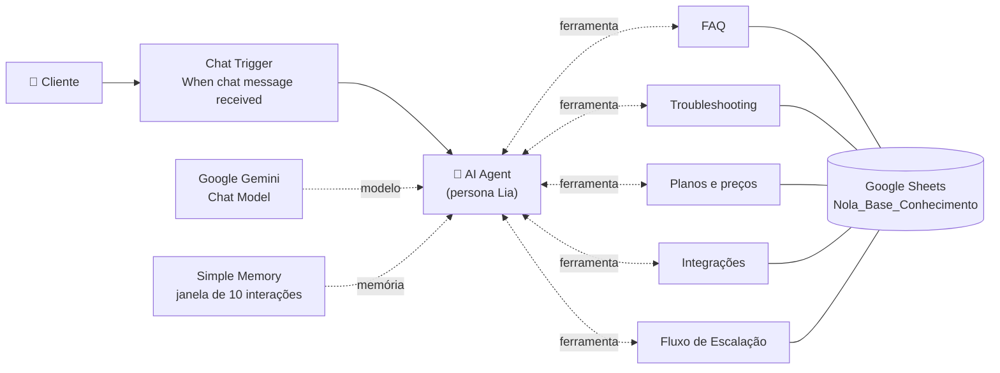

# 🤖 Lia — Agente de Atendimento com IA para a Nola

Chatbot de **Customer Success** construído em **n8n** com **Google Gemini** e **Google Sheets**, desenvolvido para o desafio prático de estágio em Customer Success da **Nola** (tecnologia e automação para food service).

A **Lia** é a primeira linha de atendimento: acolhe o cliente, tira dúvidas, resolve problemas comuns consultando uma base de conhecimento e avisa quando um caso precisa de um especialista humano.

▶️ **[Assistir à apresentação](media/Apresentacao.mp4)** · 📄 **[Relatório do desafio](docs/Relatorio_do_Desafio.docx)**

---

## O que a Lia faz

- Cumprimenta o cliente, pergunta o nome e gera um **número de protocolo** no início do atendimento.
- Responde dúvidas sobre a Nola, planos e preços e integrações (iFood, PDVs, ERPs etc.).
- Orienta a solução de problemas técnicos, coletando sistema e sintoma antes de responder.
- Identifica quando é preciso **escalar** (pedido de humano, sistema fora do ar, frustração repetida, cancelamento) e informa o cliente.
- Mantém o contexto da conversa (as últimas 10 interações) e um tom caloroso e objetivo, com no máximo 2 parágrafos curtos por resposta.

## Arquitetura

Em vez de um fluxo rígido com nós de classificação de intenção, o workflow usa um **AI Agent** como orquestrador: ele interpreta a mensagem, lembra do histórico e decide sozinho qual ferramenta consultar.



<!-- Adicione aqui um print do canvas do n8n e de uma conversa de exemplo:


-->

### Componentes

| Nó | Tipo | Função |
|---|---|---|
| When chat message received | Chat Trigger | Recebe as mensagens do cliente pelo chat do n8n |
| AI Agent | Agent | Orquestra a conversa e decide qual ferramenta usar; contém o prompt da Lia |
| Google Gemini Chat Model | Modelo de linguagem | "Cérebro" conversacional do agente |
| Simple Memory | Memória (window buffer) | Guarda as últimas 10 interações da sessão |
| FAQ, Troubleshooting, Planos e preços, Integrações, Fluxo de Escalação | Google Sheets Tool | Cada uma lê uma aba da base de conhecimento |

## Base de conhecimento

Planilha [`Nola_Base_Conhecimento.xlsx`](base-conhecimento/Nola_Base_Conhecimento.xlsx), com uma aba por ferramenta:

| Aba | Conteúdo | Itens |
|---|---|---|
| `FAQ_Geral` | Perguntas e respostas sobre a Nola e seus produtos | 15 |
| `Troubleshooting` | Problemas comuns, solução orientada e próximo passo | 12 |
| `Planos_e_Precos` | Recursos comparados entre Starter, Pro, Business e Enterprise | 15 |
| `Integracoes` | Plataformas suportadas, categoria e nível de integração | 12 |
| `Fluxo_Escalacao` | Gatilhos, destino, mensagem ao cliente e SLA | 8 |

> Os dados da planilha são fictícios, criados para o desafio.

## Prompt da Lia

O prompt completo está em [`prompts/lia-system-prompt.md`](prompts/lia-system-prompt.md) (extraído do próprio workflow) e também em [`docs/prompt.docx`](docs/prompt.docx). Ele define identidade, tom de voz, escopo da Nola, responsabilidades, limites do que ela não deve fazer, regras de escalação e formatos de resposta.

## Como executar

**Pré-requisitos:** uma instância do n8n (cloud ou self-hosted), uma conta Google e uma chave de API do Google Gemini.

1. **Copie a base para o seu Google Drive.** Envie `base-conhecimento/Nola_Base_Conhecimento.xlsx` ao Drive e abra com o Google Sheets.
2. **Importe o workflow.** No n8n, vá em *Workflows → ⋯ → Import from file* e selecione `workflow/agente-ia-nola.json`.
3. **Configure as credenciais.** O arquivo foi exportado sem credenciais, então crie/selecione:
   - *Google Sheets OAuth2 API* nos 5 nós de ferramenta;
   - *Google Gemini (PaLM) API* no nó do modelo.
4. **Aponte os 5 nós do Google Sheets para a sua cópia da planilha**, escolhendo o documento e a aba correspondente em cada nó.
5. **Teste.** Clique em *Open chat* no canvas e converse com a Lia.

## Estrutura do repositório

```
nola-agente-ia/
├── README.md
├── workflow/
│   └── agente-ia-nola.json         # workflow do n8n (sem credenciais)
├── prompts/
│   └── lia-system-prompt.md        # prompt do agente
├── base-conhecimento/
│   └── Nola_Base_Conhecimento.xlsx
├── docs/
│   ├── Relatorio_do_Desafio.docx
│   └── prompt.docx
└── media/
    └── Apresentacao.mp4
```

## Limitações conhecidas e próximos passos

Esta é uma primeira versão feita para o desafio. O que ainda não está implementado:

- **Escalação ainda é conversacional.** O prompt cita `{{webhook_humano}}`, `{{webhook_urgente}}` e `{{cliente_email}}`, mas o workflow não tem nós de webhook/HTTP/e-mail. Hoje a Lia *avisa* o cliente que vai escalar, mas nenhuma notificação é disparada. Como o campo do prompt é um texto fixo (não uma expressão do n8n), esses `{{...}}` chegam ao modelo como texto literal.
- **Protocolo e chamados não são persistidos.** O número de protocolo é gerado pelo próprio modelo e não é gravado em lugar nenhum; o "chamado registrado" também não gera e-mail nem registro.
- **Consulta ao site da Nola.** O prompt diz que a Lia pode consultar o site, mas não há ferramenta de HTTP/web configurada.
- **Memória volátil.** O *Simple Memory* vive na memória do n8n e se perde ao reiniciar; para produção, trocar por memória persistente (Postgres, Redis).
- **Canal.** O gatilho é o chat do próprio n8n. Integrar com WhatsApp ou Telegram seria um próximo passo.
- **Escala da base.** As ferramentas leem a aba inteira, o que funciona bem para bases pequenas; para bases maiores, usar filtros ou busca vetorial.

**Próximos passos sugeridos:** adicionar nós de webhook/Slack/e-mail para as escalações (incluindo `webhook_retencao`, já previsto na aba `Fluxo_Escalacao`), gravar protocolos e chamados em uma planilha ou banco, e criar um conjunto de conversas de teste para avaliar as respostas.

## Ferramentas de IA de apoio

Conforme descrito no relatório, o projeto contou com apoio de **Manus.im** (estruturação técnica e revisão do fluxo e dos prompts) e **Claude AI** (criação da base de conhecimento, sugestões de FAQ e cenários de interação).

## Autor

**Elienildo Pereira** — [LinkedIn](https://www.linkedin.com/in/elienildo-pereira/) · [GitHub](https://github.com/Elienildo-Pereira)
